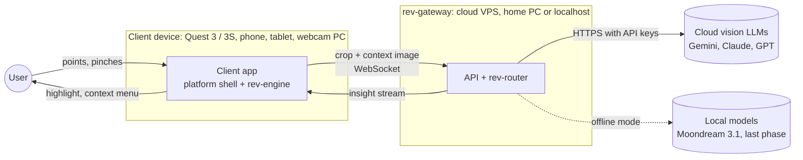
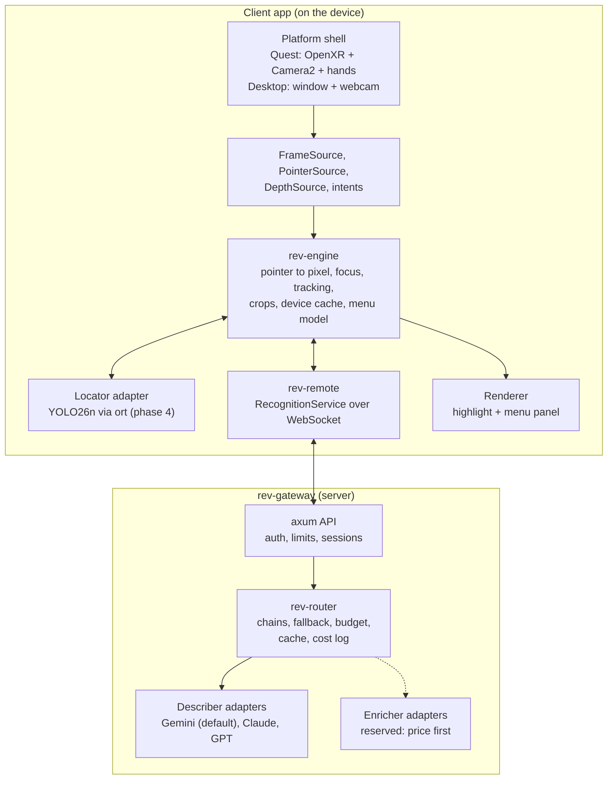

# Architecture

Status: proposed, 2026-10-25. Phase 0 (skeleton): nothing here is implemented yet.
Replaces the 2026-10-24 sketch: its content was split up, refined and extended.

This page is the overview. The details live in `docs/architecture/`:

| Page | What it covers |
| --- | --- |
| [components.md](architecture/components.md) | Every component: what it owns, its inputs and outputs, its crate and phase |
| [crates.md](architecture/crates.md) | Workspace layout, dependency rules, feature flags, build targets, testing |
| [interfaces.md](architecture/interfaces.md) | Core types and traits in Rust, plus the rules for coordinates, time, errors and streaming |
| [data-flow.md](architecture/data-flow.md) | Sequence diagrams (ask, highlight, follow-up, fallback, cancel), state machines, caching, latency |
| [client-server.md](architecture/client-server.md) | What runs where, deployment modes, gateway API and wire protocol, config, security, privacy |
| [clients.md](architecture/clients.md) | The Quest 3 / 3S client in detail, the desktop dev client, phones, protocol-only clients |

Diagrams are Mermaid, so GitHub renders them in place.

## Goal

Point at any real object, see it highlighted at once, and get a deeper description on
request. The same core serves a Quest headset, a phone, a tablet, a webcam or any other
device with a camera, and every AI model can be swapped by config.

## Principles

1. **Core knows nothing about devices.** Clients feed frames, pointers and intents through
   traits. Only crates under `apps/` touch OpenXR, Android or a window system.
2. **Core knows nothing about vendors.** Every model sits behind `Locator`, `Describer` or
   `Enricher`. Adapters convert vendor formats into core types inside the adapter.
3. **One service interface, two homes.** The client's engine calls a
   `RecognitionService`. It is either in the same process (`rev-router`) or across the
   network (`rev-remote` talking to `rev-gateway`). The engine cannot tell the difference.
4. **Latest frame wins.** Frames are never queued. A slow model skips frames; it never
   makes the highlight lag behind.
5. **Everything streams, and dropping a stream cancels it.** The menu shows the name first
   and the details as they arrive. Looking away cancels the work and its cost.
6. **Images live in memory only.** No camera image is written to disk or logs unless a
   developer turns on recording.
7. **Every model call is measured.** Latency, tokens and cost are logged per call, so
   choosing models is a matter of data, not taste.

## System context



## Components at a glance



## Two tiers, three roles

| Role | Tier | When it runs | Where | Default |
| --- | --- | --- | --- | --- |
| `Locator` | 1, fast | Every few frames, while pointing | On the device | YOLO26n through `ort` (phase 4) |
| `Describer` | 2, smart | When the user asks (pinch, tap, click) | Gateway | Gemini 3.8 Flash identifies, Gemini 4 Argon writes the details |
| `Enricher` | 2, reserved | Follow-up questions about an identified object | Gateway | Not built yet; price is the first topic |

- The `Locator` only has to box the thing under the pointer so the highlight is instant.
  Anything it cannot name is still sent to the `Describer` as a crop.
- The `Describer` runs in two stages: **identify** (short, fast: name, category,
  confidence, refined box) and **details** (summary and properties, streamed). The router
  runs each stage through its own chain of providers.
- Cloud first: until phase 4 there is no `Locator`. The pinch sends a window around the
  pointer, and the box returned by the identify stage becomes the highlight.

## Two ways to build a client

| Level | What the client does | Gets for free | Examples |
| --- | --- | --- | --- |
| **Engine client** | Embeds `rev-engine`, directly in Rust or from Kotlin / Swift through UniFFI bindings (`rev-ffi`) | Pointer resolution, Locator, tracking, crops, caches, menu state | Quest, desktop, Android, iOS |
| **Protocol-only client** | Speaks the gateway protocol (WebSocket or REST) in any language | Identification, details, follow-ups | Web page, Unity app, scripts, test tools, a camera that streams to a PC |

A device that cannot run either streams video to a companion (phone or PC) that can.

## Deployment modes

| Mode | Where the models run | Used for |
| --- | --- | --- |
| **Cloud gateway** (default) | `rev-gateway` on a server calls cloud vendors | Every client, from phase 1 |
| **Local gateway** | `rev-gateway` on the developer's PC or a home GPU box | Development; offline mode in phase 7 with Moondream 3.1 |
| **Embedded router** | `rev-router` inside the client process | Desktop development without a server; an offline laptop. Never ships with cloud API keys inside an app |

Details and the wire protocol: [client-server.md](architecture/client-server.md).

## Workspace in one screen

```
crates/    rev-core  rev-geometry  rev-imaging  rev-prompts  rev-proto
           rev-router  rev-engine  rev-remote  rev-ffi  rev-testkit
adapters/  rev-adapter-gemini  rev-adapter-anthropic  rev-adapter-openai
           rev-adapter-ort  rev-adapter-moondream
apps/      rev-gateway  rev-desktop  rev-quest  rev-bench
xtask/     dependency-rule checks and dev commands
tests/fixtures/   golden images every adapter is scored on
```

Full table, dependency graph and rules: [crates.md](architecture/crates.md).

## Which phase builds what

| Phase (see `docs/roadmap.md`) | Components |
| --- | --- |
| 0. Skeleton | Workspace, `rev-core` types and traits, empty crates, `xtask check-deps`, CI |
| 1. Cloud spike on the desktop | `rev-proto`, `rev-prompts`, `rev-router`, `rev-gateway`, `rev-adapter-gemini`, `rev-remote`, minimal `rev-engine`, `rev-imaging`, `rev-desktop` |
| 2. Scoring harness | `rev-testkit`, `rev-bench`, `tests/fixtures/`, Anthropic and OpenAI adapters |
| 3. Quest client, cloud only | `rev-quest`, `rev-geometry`, recording and replay |
| 4. On-device Locator | `rev-adapter-ort`, tracking and focus in `rev-engine`, live highlight |
| 5. Enricher | First `Enricher` adapter (price), follow-up menu entries |
| 6. More clients | `rev-ffi`, Android shell |
| 7. Offline mode | `rev-adapter-moondream`, local gateway profile |

## Swapping a model

1. Add an adapter crate under `adapters/` that implements the trait and converts to core
   types. It depends on `rev-core` and `rev-prompts` only.
2. Run the contract tests (`rev-testkit`) and the scoring harness (`rev-bench`) on
   `tests/fixtures/`.
3. Register it behind a Cargo feature in the app that hosts it and add it to a chain in
   config. No other crate changes.

## Glossary

| Term | Meaning |
| --- | --- |
| Frame | One camera image with its capture time and, when known, the camera's intrinsics and pose |
| Pointer | Where the user aims: a pixel (tap, click) or a 3D ray (hand, controller, head gaze, eye gaze) |
| Focus | The object the engine currently treats as "the one being pointed at" |
| Track | A detection followed across frames, with a stable id |
| Crop | The part of a frame around the focused object, sent to the `Describer` |
| Context image | The whole frame, downscaled, with the target outlined, sent along with the crop |
| Identity | The fast answer: name, category, confidence, box |
| Insight | Everything the menu shows about one object: identity, summary, properties, provenance |
| Chain | Ordered list of providers for one stage; the router falls back along it |
| Engine | `rev-engine`, the client-side brain shared by all engine clients |
| Gateway | `rev-gateway`, the server that holds API keys and runs the router |
