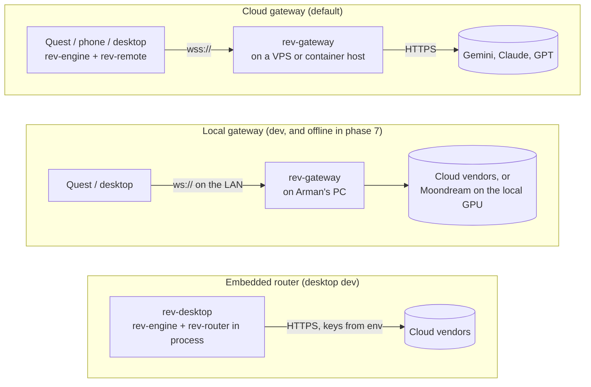
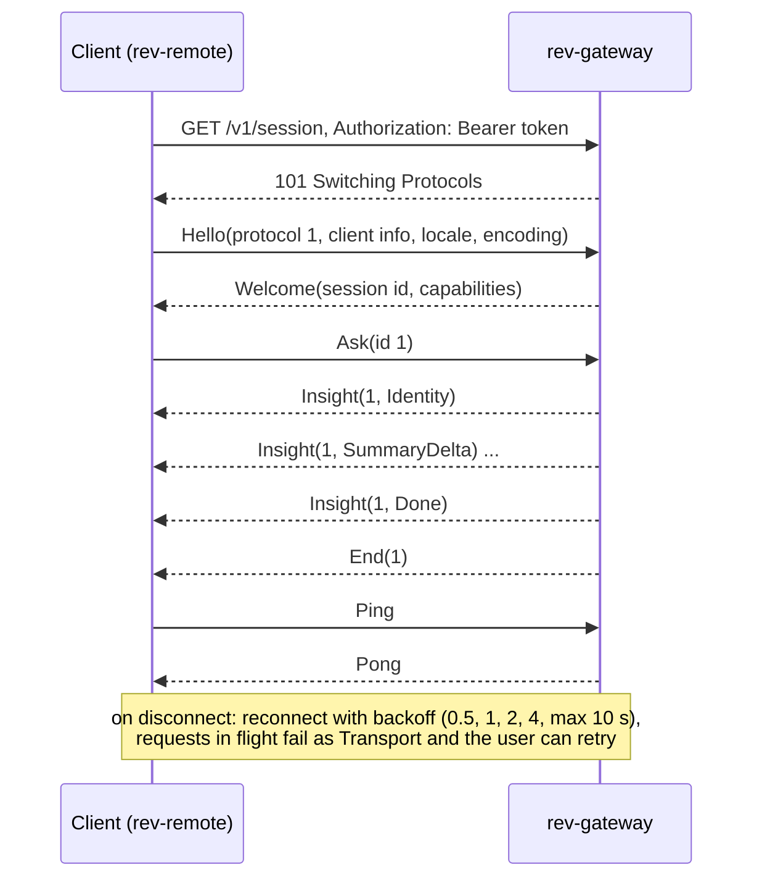

# Client and server

Status: proposed, 2026-10-25. What runs on the device, what runs on the gateway, and how
they talk.

## What runs where

| Component | Device | Gateway | Why |
| --- | --- | --- | --- |
| Camera, pointer, depth, intents | yes | | Only the device has them |
| Pointer resolution, focus, tracking | yes | | Needs poses at capture time and must be instant |
| `Locator` (phase 4) | yes | | Runs every few frames; a network round trip is too slow |
| Crop and context image | yes | | Sends a small JPEG instead of a video stream |
| Device cache | yes | | Re-asking about a tracked object is instant and free |
| Menu state and rendering | yes | | UI is local |
| `Describer`, `Enricher` | | yes | Needs API keys and big models |
| Chains, fallback, hedging | | yes | Change models without shipping an app update |
| Budget and rate limits | | yes | Cannot be trusted to the client |
| Gateway cache | | yes | Shared across a user's devices |
| Prompts and schemas | | yes | Tune prompts without an app update |

## Deployment modes



Embedded mode is for development and offline laptops only. A shipped app never contains
cloud API keys.

## Who runs the gateway (open question)

The architecture supports all three; the choice affects the budget question in
`docs/decisions.md`.

| Option | Who pays for model calls | Fits |
| --- | --- | --- |
| Self-hosted, bring your own keys | Each user | Open-source users and developers. Needs nothing from Arman beyond docs and a Docker image |
| One hosted gateway run by the project | The project | A store release where users just install the app. Needs accounts, budgets and abuse protection |
| Both | Mixed | The client takes a gateway URL and token in settings; the hosted one is the default |

Recommendation: build for self-hosting first (it is needed for development anyway) and
decide on a hosted gateway before a store release.

## Gateway API

Base path `/v1`. TLS everywhere except `localhost` and the LAN in dev mode.

| Method and path | Body | Response | Use |
| --- | --- | --- | --- |
| `GET /v1/health` | | `200 ok` | Load balancers, monitoring |
| `GET /v1/capabilities` | | JSON `ServiceCapabilities` | Topics, limits, budget left |
| `GET /v1/session` | WebSocket upgrade | `ServerMsg` stream | Main channel for engine clients |
| `POST /v1/ask` | `multipart/form-data`: `meta` (JSON), `crop` (JPEG), optional `context` (JPEG) | NDJSON of `InsightEvent`, or SSE with `Accept: text/event-stream` | Protocol-only clients, curl, tests |
| `POST /v1/enrich` | JSON | NDJSON or SSE of `EnrichEvent` | Same, for follow-ups |
| `GET /metrics` | | Prometheus text | Separate admin port, not public |

Why WebSocket for the main channel: one connection kept open (no TLS handshake per pinch),
requests multiplexed by id, cancellation as a message, and the server can push. REST stays
for clients where a socket is a burden.

## Wire protocol

Defined in `rev-proto`. Messages are tagged enums; a round trip in both encodings was
tested in a scratch crate on 2026-10-25.

```rust
pub const PROTOCOL_VERSION: u16 = 1;

pub struct ClientInfo {
    pub app: String,
    pub version: String,
    pub platform: String,            // "quest", "android", "ios", "desktop", "web"
    pub device_model: Option<String>,
}

pub enum Encoding { MessagePack, Json }

#[serde(tag = "type", rename_all = "snake_case")]
pub enum ClientMsg {
    Hello { protocol: u16, client: ClientInfo, locale: String, region: Option<String>, encoding: Encoding },
    Ask {
        id: RequestId,
        crop: Bytes,                  // JPEG
        crop_in_frame: BBox,
        context: Option<Bytes>,       // JPEG, downscaled frame with the target outlined
        hint: Option<Label>,
        details: DetailsMode,
        known: Option<Identity>,      // skip identify
    },
    Enrich { id: RequestId, object: Box<ObjectInsight>, topic: Topic, question: Option<String> },
    Cancel { id: RequestId },
    Ping { nonce: u32 },
}

#[serde(tag = "type", rename_all = "snake_case")]
pub enum ServerMsg {
    Welcome { protocol: u16, session: String, capabilities: ServiceCapabilities },
    Insight { id: RequestId, event: InsightEvent },
    Enrichment { id: RequestId, event: EnrichEvent },
    End { id: RequestId },
    Error { id: Option<RequestId>, error: ServiceError },
    Pong { nonce: u32 },
}
```

### Encoding

- **MessagePack** (`rmp-serde`, named fields) in binary WebSocket frames by default. Images
  travel as raw bytes, with no base64 overhead.
- **JSON** in text frames when `Hello.encoding` is `Json`: for web clients and for reading
  traffic while debugging. Bytes become base64 in this mode.
- One message per WebSocket frame.

### Session



### Versioning

- The path carries the major version (`/v1`). `PROTOCOL_VERSION` is checked in `Hello`; the
  gateway answers with `Error(Protocol)` and closes if it cannot serve that version.
- Within a version, only additive changes: new optional fields and new message or event
  types. Receivers ignore message types they do not know.
- Prompt versions and model choices are invisible to the protocol; they show up only in
  `Provenance`.

## Auth, limits and budget

| Concern | Phase 1 | Later |
| --- | --- | --- |
| Auth | Static bearer tokens listed in gateway config (one per device or user), sent at the WebSocket upgrade. Browsers, which cannot set headers on a WebSocket, send it as the `Sec-WebSocket-Protocol` value | Accounts (OAuth) if a hosted gateway is run |
| Rate limits | Per token: requests per minute, requests in flight per session (4) | Per account and per IP |
| Size limits | Crop up to 1.5 MB and 2048 px on the long side; context up to 0.5 MB | Tuned from real traffic |
| Budget | Ledger per token per month in micro-dollars; limit from config; `BudgetExceeded` when spent | Numbers decided with Arman (open question) |

## Configuration

### Gateway (`rev-gateway.toml`)

Loaded with `figment`: file first, then environment variables (`REV_...`) on top. Model
names and prices are examples; check the vendor's current IDs and prices when
implementing.

```toml
[server]
listen = "0.0.0.0:8080"
admin_listen = "127.0.0.1:9090"     # /metrics

[auth]
tokens_env = "REV_TOKENS"           # "name:token,name:token"; never in the file

[limits]
max_crop_bytes = 1_500_000
max_in_flight_per_session = 4
requests_per_minute = 30

[budget]
monthly_limit_usd = 5.0             # placeholder until decided

[cache]
ttl_secs = 86400
max_entries = 50_000
scope = "token"                     # or "global"

[stages.identify]
chain = ["gemini-flash", "claude-sonnet"]
timeout_ms = 2500
hedge_after_ms = 1500

[stages.details]
chain = ["gemini-argon", "claude-opus"]
timeout_ms = 8000
mode = "after_identify"             # default DetailsMode for clients that do not say

# [stages.enrich.price]             # reserved for phase 5
# chain = ["..."]

[providers.gemini-flash]
adapter = "gemini"
model = "gemini-3.8-flash"
api_key_env = "GEMINI_API_KEY"
input_per_mtok = 0.825
output_per_mtok = 4.13

[providers.gemini-argon]
adapter = "gemini"
model = "gemini-4-argon"
api_key_env = "GEMINI_API_KEY"
input_per_mtok = 2.0
output_per_mtok = 10.0

[providers.claude-sonnet]
adapter = "anthropic"
model = "claude-sonnet-5-5"
api_key_env = "ANTHROPIC_API_KEY"
input_per_mtok = 2.0
output_per_mtok = 10.0

[providers.claude-opus]
adapter = "anthropic"
model = "claude-opus-5-5"
api_key_env = "ANTHROPIC_API_KEY"
input_per_mtok = 4.0
output_per_mtok = 20.0
```

The same `[stages]` and `[providers]` sections configure the embedded router in
`rev-desktop` and the scoring harness in `rev-bench`.

### Client (`rev-client.toml`, or settings UI on the headset)

```toml
gateway_url = "wss://rev.example.org/v1/session"
token_env = "REV_TOKEN"             # desktop; on Quest the token is entered once in settings
locale = "en-US"
region = "US"                       # ISO 3166-1, used for prices and currency
pointer = "hand"                    # "hand", "head", "auto" (hand when tracked, else head)
details = "after_identify"
locator = true
locator_fps = 15
```

## Security

- API keys only in the gateway's environment. Never in client builds, config files, git or
  chat.
- TLS for every non-local connection; the gateway can terminate TLS itself (`rustls`) or
  sit behind Caddy or a cloud load balancer.
- Inputs are validated before any model call: message size, image size and format, decoded
  dimensions.
- Text visible in the camera image can try to steer the model ("ignore your
  instructions"). Answers are schema-constrained JSON shown as plain text, nothing in the
  pipeline acts on model output, and the `Enricher` may only search and cite, never act.
- `cargo deny` checks advisories and licenses in CI.

## Privacy

- Camera images stay in memory on the gateway for the duration of a request and are then
  dropped. They are not written to disk, logs or the cache. Logs carry hashes, sizes and
  timings only.
- The vendor receives the crop and the context image. Their data-retention terms apply;
  prefer API tiers that do not train on inputs, and say so in the app's privacy policy.
- Meta treats passthrough camera images as Device User Data. A store release needs a
  privacy policy that covers sending crops to the gateway and to the vendors.
- Recording is a dev-only feature, off by default, and shows an indicator while it runs.

## Observability

| Signal | What | Where |
| --- | --- | --- |
| Traces | One span per request, child spans per stage and provider attempt | `tracing`, JSON logs; OpenTelemetry export optional |
| Metrics | `rev_requests_total{stage,provider,outcome}`, `rev_latency_seconds{stage,provider}` (histogram), `rev_cost_usd_total{provider}`, `rev_cache_hits_total{level}`, `rev_sessions_active` | Prometheus at `/metrics` |
| Cost log | Every provider call with tokens and cost, per token | Structured log line; input for the budget ledger |
| Client timings | Capture to request, request to identity, identity to done | Sent as optional fields in `Ask` later; logged locally now |
| Visual debugging | Frames, boxes, rays, focus | Rerun, dev builds of the clients only |

## Hosting the gateway

A single static binary and a small Docker image (`FROM gcr.io/distroless/cc`). Any
container host or VPS works; it needs no database in phase 1. It is stateless apart from
the in-memory cache and budget ledger, so restarts are safe; the ledger moves to SQLite
before real users rely on budgets.
