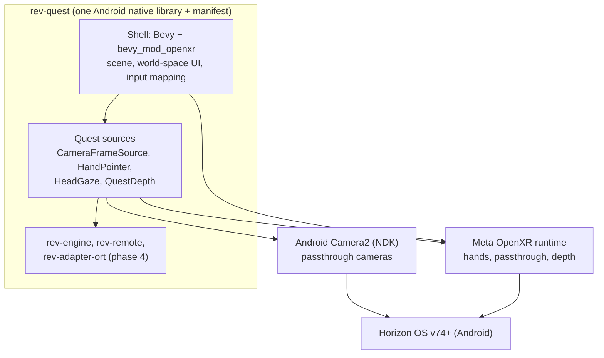
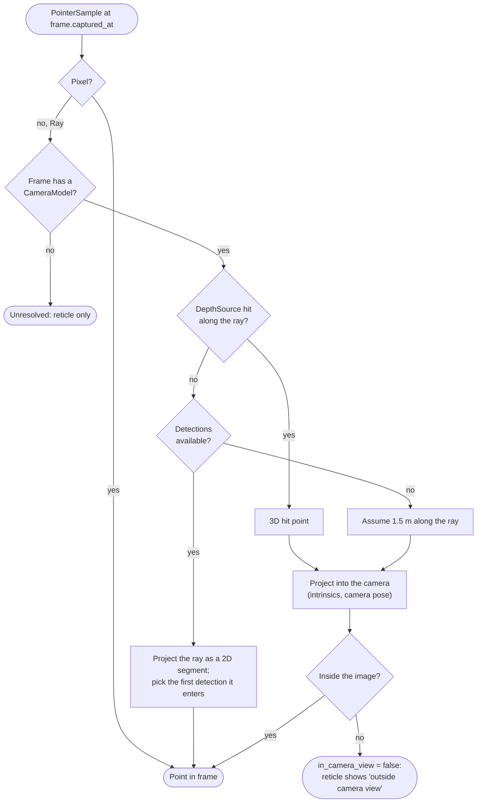

# Clients

Status: proposed, 2026-10-25. How each kind of device plugs into the same core. The two
integration levels (engine client, protocol-only client) are explained in the
[overview](../architecture.md#two-ways-to-build-a-client).

## Quest 3 / 3S (`apps/rev-quest`, phase 3)

### Stack



### Shell choice

**Recommended: Bevy with `bevy_mod_openxr`.** It brings a renderer, world-space text and UI,
an ECS to organise the scene, and Quest support with passthrough, which is most of what the
client needs. Risks: APK size, startup time, and Bevy's release churn (the `bevy_mod_xr`
version must match the Bevy version).

**Fallback: the raw `openxr` crate with `wgpu`** and a small hand-made UI. More work, full
control.

The phase 3 spike decides: passthrough, a hand ray, and a world-space text panel running at
90 Hz on a Quest 3. If Bevy cannot hold that, switch to the fallback before anything else
is built on top.

### OpenXR extensions

| Extension | Use |
| --- | --- |
| `XR_FB_passthrough` | Show the real world behind our content |
| `XR_EXT_hand_tracking` | Hand joints |
| `XR_FB_hand_tracking_aim` | Aim pose (the pointer ray) and pinch state (the Ask gesture) |
| `XR_META_environment_depth` | Depth API: where a ray hits the real world |
| `XR_KHR_convert_timespec_time` | Map Camera2 timestamps to `XrTime` (support to be checked in the spike) |
| `XR_FB_display_refresh_rate` | Pick 72 or 90 Hz |

### Camera pipeline

1. Permissions: `android.permission.CAMERA` and `horizonos.permission.HEADSET_CAMERA`,
   asked at runtime. Horizon OS v74 or later.
2. Open a passthrough camera through NDK Camera2 (`ACameraManager`). Meta marks the
   passthrough cameras and their side (left or right) with vendor metadata keys; start
   with one camera.
3. `AImageReader` in `YUV_420_888`, 1280x960 to start (higher resolutions exist on newer OS
   versions), 30 fps, which is plenty for the Locator. At most three images in flight.
4. For each image: copy the planes into `Bytes`, convert the timestamp to `XrTime`, and
   attach a `CameraModel`:
   - intrinsics from `LENS_INTRINSIC_CALIBRATION`,
   - camera-to-head offset from `LENS_POSE_TRANSLATION` and `LENS_POSE_ROTATION`,
   - head pose at capture time from `xrLocateSpace` at that timestamp.
5. Replace the latest-frame slot; release the image.

### Time alignment

The camera, the hands and the head all have to agree on "when". Camera2's
`SENSOR_TIMESTAMP` uses the clock named by `SENSOR_INFO_TIMESTAMP_SOURCE` (`REALTIME` means
`CLOCK_BOOTTIME`). Convert it to `CLOCK_MONOTONIC`, then to `XrTime`. The spike verifies it
by moving the head while pointing at a fixed object: a highlight that trails or leads the
object means the clocks are off.

### Pointer modes and gestures

| Mode | Ray | When |
| --- | --- | --- |
| Hand (default) | Aim pose from `XR_FB_hand_tracking_aim` | Hands tracked |
| Head gaze | Center of view, -Z | Hands not tracked (in `auto` mode) or chosen in settings |
| Controller | Controller aim pose | Controllers in hand |

The shell samples the pointer every XR frame into a 500 ms history, so the engine can ask
for it at a frame's capture time.

| Gesture | Intent |
| --- | --- |
| Pinch while pointing at an object (rising edge, 150 ms debounce), or trigger | `Ask` |
| Pinch while pointing at a menu button | That button's action (`Retry`, `MoreDetails`, `FollowUp`, `Close`) |
| Pinch on empty space while the menu is open | `Dismiss` |
| Head gaze mode: pinch with either hand anywhere | Same as above, aimed by the head |

### Pointer resolution

The engine turns a pointer sample into a point in the frame. Logic in `rev-geometry`,
shared by every client.



A hand ray starts at the hand, not at the camera, so without depth it projects to a line
in the image, not a point. That is why depth comes first and the fixed distance last.
Head gaze starts near the cameras, so it projects to almost the same point at any depth.

### Rendering and anchoring

- The passthrough compositor shows the real world; the app only draws on top of it in 3D.
  Image-space boxes therefore become world positions: a ray from the camera through the
  box center, the Depth API distance along it, and the box's angular size for scale
  (`Anchor.world`, computed by the engine).
- **Highlight:** a rounded frame facing the user at the anchor. Thin while `Candidate`,
  solid while `Focused`, pulsing while asking.
- **Menu:** a world-locked panel beside the object (right side, or above when there is no
  room), turned toward the user, kept at a constant angular size so it stays readable.
  It stays where it is until the next ask or dismiss.
- The passthrough cameras see less than the user's full field of view. Pointing outside it
  gives `in_camera_view = false` and a hint on the reticle.

### Performance budget

| Item | Budget |
| --- | --- |
| Render thread at 90 Hz | 11.1 ms per frame in total; our own CPU work under 2 ms |
| Locator | About 15 Hz on worker threads, adaptive: 5 Hz when not pointing, off when hands are down |
| Camera stream | About 1 to 2% GPU and 45 MB of memory per stream (Meta figure) |
| Network | One WebSocket, idle except for pings between asks |

### Build and packaging

- A small Gradle project in `apps/rev-quest/android/` holds the manifest, the Khronos
  OpenXR loader and the app icon; `cargo ndk -t arm64-v8a` builds the Rust library into it.
  `xbuild` is the Gradle-free alternative; the spike picks one.
- Manifest: `CAMERA`, `horizonos.permission.HEADSET_CAMERA`,
  `com.oculus.permission.HAND_TRACKING`, `com.oculus.permission.USE_SCENE` (needed for
  depth), `INTERNET`; features `oculus.software.handtracking` and
  `com.oculus.feature.PASSTHROUGH`; the VR intent category; supported devices Quest 3
  and 3S.
- Logs go to `logcat` through a `tracing` layer; Rerun can stream to the PC over Wi-Fi in
  dev builds.
- Install and test through a Remote Control session on Arman's PC (`adb install -r`).

## Desktop dev client (`apps/rev-desktop`, phase 1)

The main development loop for phases 1 and 2 and for replaying Quest recordings.

- `eframe` / `egui` window with the camera view: webcam (`nokhwa`), image file or folder
  (drag and drop), or a recording.
- Click sets the pointer (`PointerKind::Mouse`); click or Space asks; Esc dismisses.
- Side panel shows the menu; a debug panel shows timings per stage, provenance and cost.
- Talks to a gateway by default; the `embedded` feature runs the router in process with
  keys from the environment.
- Optional Rerun logging of frames, boxes and pointer.

## Android phone and tablet (phase 6)

| Option | Shell | Engine | Verdict |
| --- | --- | --- | --- |
| A | Kotlin: CameraX preview, touch, Jetpack Compose UI | `rev-engine` through `rev-ffi` (UniFFI) | **Recommended.** Native UI and CameraX's handling of device quirks; the engine is the shared value |
| B | Pure Rust: `android-activity`, NDK camera, egui | Direct | One language, but a weaker phone UI and more camera work |

A tap is a `Pixel` pointer, so phones need no depth or camera pose. ARCore can add depth
and stable anchors later.

iOS is not on the roadmap. If it comes, it follows option A with Swift, AVFoundation and
the same `rev-ffi` bindings.

## Protocol-only clients

Anything that can send a JPEG and read a stream:

- **Web page:** `getUserMedia` for the camera, click to point, crop in a canvas,
  `POST /v1/ask` or the WebSocket with JSON encoding. Useful for demos.
- **Unity or Godot apps, smart-glasses companion apps, IP cameras:** a few lines of
  HTTP.

The minimum a client sends is a crop and where it sits in the frame
(`crop_in_frame`); a context image and a hint make answers better.

## Recordings

A recording is a folder, kept out of git (project files or Git LFS):

```
recordings/2026-11-03T18-20-00_quest3/
  session.toml          device, app version, frame size, camera intrinsics, clock notes
  events.jsonl          one event per line: frame (id, time, file, camera pose),
                        pointer sample, intent, depth hit for the pointer ray
  frames/000001.jpg     JPEG, quality 90
```

`rev-engine`'s `replay` module turns a recording back into `FrameSource`, `PointerSource`
and `DepthSource`, either in real time or as fast as possible for tests. Depth is stored
only as the hit distance for each recorded pointer ray, not as full depth maps, so replayed
depth answers only for rays close to a recorded one. A Rerun export makes recordings easy
to inspect.
