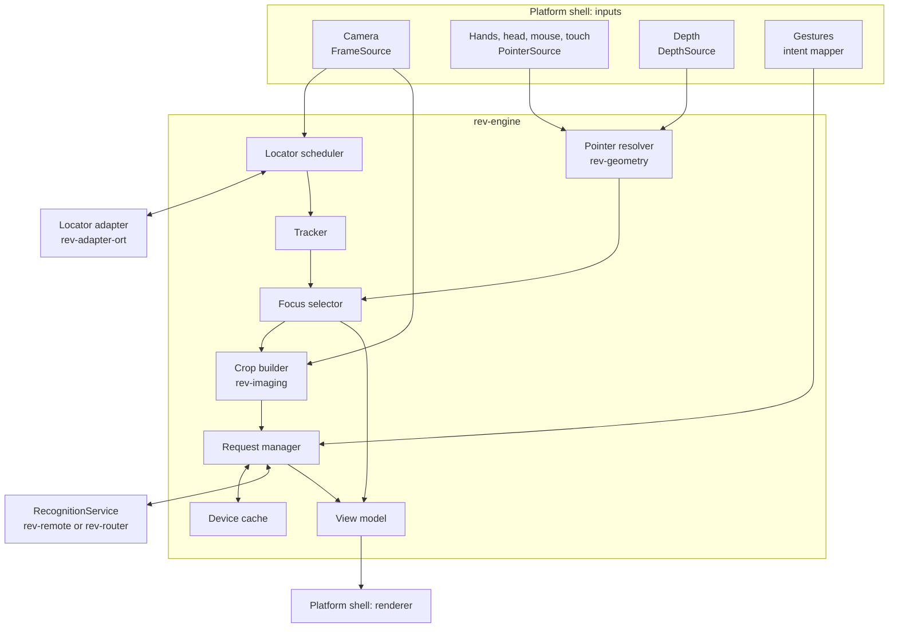

# Components

Status: proposed, 2026-10-25. Every component the app needs, where it lives and when it gets
built. Types and traits named here are defined in [interfaces.md](interfaces.md).

## Map

## Client side

### Platform shell

| | |
| --- | --- |
| Owns | App lifecycle, permissions, XR session or window, render loop, threads |
| In | OS and XR runtime events |
| Out | Implementations of `FrameSource`, `PointerSource`, `DepthSource`; `IntentEvent`s; draws `ViewState` |
| Crates | `apps/rev-quest` (phase 3), `apps/rev-desktop` (phase 1), Android shell (phase 6) |
| Rule | The only place that may depend on OpenXR, Android NDK, JNI, Bevy, winit or egui |

### FrameSource implementations

| Implementation | Where | Notes |
| --- | --- | --- |
| Quest passthrough camera | `rev-quest` | Android Camera2 through the NDK, YUV_420_888, one of the two front cameras first. Carries intrinsics and the camera pose at capture time |
| Webcam | `rev-desktop` | `nokhwa`; no intrinsics needed (pointer is already a pixel) |
| Image file and folder | `rev-desktop`, `rev-bench` | Drag and drop, fixtures |
| Recording replay | `rev-engine` (`replay` module) | Plays back a recorded session with its original timing, so Quest bugs can be debugged on the desktop |

All of them keep only the newest frame (`latest()`); older frames are dropped.

### PointerSource implementations

| Implementation | Device | Notes |
| --- | --- | --- |
| Hand aim ray | Quest | OpenXR `XR_FB_hand_tracking_aim` aim pose; default pointer |
| Controller ray | Quest | When controllers are held |
| Head gaze | Quest | Ray from the center of view. Fallback when hands are not tracked, and a user setting. Quest 3 / 3S have no eye tracking |
| Eye gaze | Devices with eye tracking | Optional, same `Ray` shape |
| Mouse, touch | Desktop, phone | Already a `Pixel` |

Ray pointers keep about 500 ms of pose history so `sample_at(frame.captured_at)` can return
where the hand was when the camera took the frame, not where it is now.

### DepthSource implementations

| Implementation | Device | Notes |
| --- | --- | --- |
| Quest Depth API | Quest 3 / 3S | `XR_META_environment_depth`; needs the spatial data permission |
| ARCore depth | Android, later | Optional |
| None | Desktop, simple phones | The engine falls back to other strategies (see [clients.md](clients.md#pointer-resolution)) |

### Intent mapper

Turns raw input into `Intent`s, inside the shell: Quest pinch (aim state bit from
`XR_FB_hand_tracking_aim`) or controller trigger, desktop click or key, phone tap, and later
dwell or voice. Head gaze mode still uses a pinch: the hand acts as a clicker.

### rev-engine

The client-side brain, shared by every engine client. Platform-free: it sees only traits.

| Sub-component | Job | Phase |
| --- | --- | --- |
| Pointer resolver | Pointer sample at the frame's capture time to a point in the frame, using the camera model and depth (logic in `rev-geometry`) | 1 (pixel), 3 (rays) |
| Locator scheduler | Runs the `Locator` on the latest frame at `locator_fps` on its own thread; skips a frame if the last run is still busy | 4 |
| Tracker | Associates detections across frames into stable `TrackId`s (`trackforge`, ByteTrack) | 4 |
| Focus selector | Picks the detection under or nearest the pointer, with hysteresis: focus moves only after the pointer rests on a new object for `switch_after`, and survives `keep_lost_for` when the track drops out | 4 |
| Crop builder | On Ask: chooses the sharpest of the last few frames, crops the focus box plus padding (or a window around the pointer without a Locator), builds the context image with the target outlined, encodes JPEG (logic in `rev-imaging`) | 1 |
| Device cache | `TrackId` to insight for the current session, and a small perceptual-hash LRU, so re-asking about the same object is instant and free | 1 (hash), 4 (tracks) |
| Request manager | One active ask at a time: a new ask or a dismiss drops the old stream (which cancels it). Applies timeouts and retry, turns the event stream into menu updates | 1 |
| View model | Publishes `ViewState` (reticle, highlight, menu) latest-wins for the renderer | 1 |
| Replay | `FrameSource` and `PointerSource` that read a recording | 3 |

### Locator adapters (on device)

| Adapter | Models | Phase |
| --- | --- | --- |
| `rev-adapter-ort` | YOLO26n (default), RF-DETR Nano (Apache 2.0 fallback), later YOLOE-26 for open vocabulary | 4 |
| Possible later | Burn on the Vulkan GPU if `ort` on CPU is too slow on Quest (decided by the phase 4 benchmark) | 4 |

### rev-remote

`RecognitionService` over the network. Opens one WebSocket session to the gateway, keeps it
alive (ping, reconnect with backoff), multiplexes requests by `RequestId`, and sends
`Cancel` when the engine drops a stream. Phase 1.

### Renderer

Draws `ViewState`. Each client renders its own way:

| Client | Highlight | Menu |
| --- | --- | --- |
| Quest | 3D frame placed at the depth hit behind the box center, sized from the box's angular size | World-locked panel next to the object, turned toward the user |
| Desktop | Box or mask drawn over the camera image | Side panel |
| Phone | Box over the camera preview | Bottom sheet |

### Recorder (dev builds)

Writes frames, camera models, pointer samples and intents to a session folder for replay.
Off by default and never in release builds. See [clients.md](clients.md#recordings).

## Gateway side

### API layer (`rev-gateway`)

| | |
| --- | --- |
| Owns | HTTP and WebSocket endpoints, TLS (or a reverse proxy), auth tokens, rate limits, size limits, protocol version check |
| In | `ClientMsg` over WebSocket; REST requests |
| Out | `ServerMsg` stream; REST responses (NDJSON or SSE) |
| Phase | 1 |

### Session manager (`rev-gateway`)

One task per WebSocket connection and one task per request. Maps `Ask` and `Enrich` to
router calls and `Cancel` to dropping the matching stream. Enforces a per-session limit on
requests in flight.

### Router (`rev-router`)

The provider orchestrator. Implements `RecognitionService`, so the gateway, the desktop
app (embedded mode) and tests all use the same code.

| Job | How |
| --- | --- |
| Stages | `locate`, `identify`, `details`, `enrich.<topic>`, each with its own chain |
| Chains | Ordered providers; next one on timeout, rate limit, unavailable, bad response or rejection |
| Hedging | Optional: start the next provider if the first has not answered after `hedge_after_ms`; keep the first answer |
| Validation | Every answer is checked against the schema in `rev-prompts`; boxes must be inside 0..1; out-of-range values are a `BadResponse` |
| Coordinates | Maps boxes from crop space to frame space (`BBox::to_parent`) |
| Assembly | Merges identity, summary and properties into one `ObjectInsight` with provenance |
| Budget | Checks the caller's budget before a call (estimate) and records actual cost after |
| Cache | Looks up and stores finished insights |
| Telemetry | One `tracing` span per call with provider, model, latency, tokens and cost |

### Provider registry (`rev-router`)

Builds adapter instances from config. Adapters do not depend on the router: the app that
hosts the router (gateway, desktop) registers each adapter's constructor behind a Cargo
feature. See [crates.md](crates.md#feature-flags).

### Budget guard (`rev-router`)

Keeps a ledger per auth token per month in micro-dollars. Limits come from config; the
actual monthly budget per user is still an open question in `docs/decisions.md`. In
memory first, a small SQLite file once the gateway runs for real users.

### Gateway cache (`rev-router`)

In-memory (`moka`), keyed by the crop's perceptual hash plus everything that changes the
answer (see [data-flow.md](data-flow.md#caching)). Scoped per auth token by default.

### Prompt and schema registry (`rev-prompts`)

One versioned prompt per stage and one JSON schema per answer type, derived from Rust types
with `schemars`. Adapters map them to each vendor's structured-output feature. The prompt
version is part of the cache key and of each insight's provenance.

### Describer adapters

| Adapter | Default use | Phase |
| --- | --- | --- |
| `rev-adapter-gemini` | Identify (Gemini 3.8 Flash) and details (Gemini 4 Argon) | 1 |
| `rev-adapter-anthropic` | Alternative vendor (Claude Opus 5.5, Sonnet 5.5) | 2 |
| `rev-adapter-openai` | Alternative vendor (GPT-6.1 Sol, GPT-5.6 Luna for budget) | 2 |
| `rev-adapter-moondream` | Offline mode, Moondream 3.1 on a local GPU | 7 |

Each one is a thin `reqwest` + `serde` client with streaming (SSE) where the vendor
supports it. Model IDs and prices live in config, never in code.

### Enricher adapters (reserved)

A model with a web-search tool behind the `Enricher` trait, price first. Answers must carry
sources. Phase 5. Nothing is built before then, but the trait, the `FollowUp` intent, the
protocol message and the menu section exist from the start so adding it is not a breaking
change.

### Telemetry

`tracing` everywhere; `tracing-subscriber` with JSON output on the gateway; Prometheus
metrics at `/metrics`; optional OpenTelemetry export. Rerun for visual debugging in dev
builds of the clients. See [client-server.md](client-server.md#observability).

## Shared and tooling

| Crate | Job |
| --- | --- |
| `rev-core` | Types and traits only |
| `rev-geometry` | Camera model, ray to pixel, unprojection with depth, box math (`glam`) |
| `rev-imaging` | YUV to RGB, crop, resize, JPEG encode, sharpness score, perceptual hash |
| `rev-prompts` | Prompts and JSON schemas |
| `rev-proto` | Wire messages and their encoding |
| `rev-ffi` | UniFFI bindings of `rev-engine` for Kotlin and Swift shells |
| `rev-testkit` | Contract test suites for each trait, fixture loader, deterministic fakes for engine tests |
| `rev-bench` | Scoring harness: runs adapters over `tests/fixtures/`, reports accuracy, latency and cost |
| `xtask` | `cargo xtask check-deps` and other dev commands |
