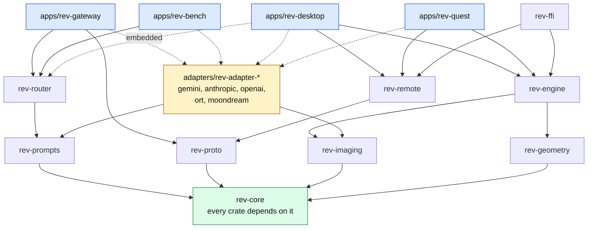

# Crates

Status: proposed, 2026-10-25. The Cargo workspace does not exist yet; this is the plan for
phase 0. `rev` = Recognize Everything VR, the prefix of every crate.

## Layout

```
Cargo.toml                 workspace: members, shared versions, lints, profiles
rust-toolchain.toml        stable, with the aarch64-linux-android target
deny.toml                  cargo-deny: licenses, advisories, duplicate versions
crates/
  rev-core/                types and traits; no vendor code, no I/O, no runtime
  rev-geometry/            camera model, ray to pixel, unprojection, box math
  rev-imaging/             YUV to RGB, crop, resize, JPEG, sharpness, perceptual hash
  rev-prompts/             versioned prompts and JSON schemas for every stage
  rev-proto/               wire messages between clients and the gateway
  rev-router/              chains, fallback, hedging, budget, cache; RecognitionService
  rev-engine/              client brain: focus, tracking, crops, requests, view model
  rev-remote/              RecognitionService over WebSocket to rev-gateway
  rev-ffi/                 UniFFI bindings of rev-engine for Kotlin and Swift (phase 6)
  rev-testkit/             contract test suites, fixture loader, fakes (dev-dependency)
adapters/
  rev-adapter-gemini/      Describer (phase 1)
  rev-adapter-anthropic/   Describer (phase 2)
  rev-adapter-openai/      Describer (phase 2)
  rev-adapter-ort/         Locator: YOLO26n, RF-DETR Nano via ONNX Runtime (phase 4)
  rev-adapter-moondream/   Describer and Locator, local GPU (phase 7)
apps/
  rev-gateway/             axum server binary (phase 1)
  rev-desktop/             dev client: webcam, images, replay (phase 1)
  rev-quest/               Quest 3 / 3S OpenXR app, Android (phase 3)
  rev-bench/               scoring harness CLI (phase 2)
xtask/                     cargo xtask check-deps, fixtures, release helpers
tests/fixtures/            golden images with expected answers
docs/
```

Directory name = crate name, so a path always tells you the crate.

## What each crate depends on

| Crate | Internal deps | Key external crates | Builds for |
| --- | --- | --- | --- |
| `rev-core` | none | `serde`, `thiserror`, `async-trait`, `futures-core`, `bytes` | all |
| `rev-geometry` | core | `glam` | all |
| `rev-imaging` | core | `yuv`, `fast_image_resize`, `image` (JPEG encode and decode), `imageproc` | all |
| `rev-prompts` | core | `schemars`, `serde_json` | all |
| `rev-proto` | core | `rmp-serde`, `serde_json` | all |
| `rev-router` | core, prompts | `tokio`, `futures`, `moka`, `tracing`, `toml` | host, android |
| `rev-engine` | core, geometry, imaging | `tokio` (rt, sync, time), `trackforge`, `tracing` | all |
| `rev-remote` | core, proto | `tokio-tungstenite` (rustls), `futures`, `tracing` | all |
| `rev-ffi` | core, engine, remote | `uniffi` | android, ios |
| `rev-testkit` | core, prompts | `wiremock`, `image`, `serde_json` | host |
| `rev-adapter-gemini` / `-anthropic` / `-openai` | core, prompts, imaging | `reqwest` (rustls, stream), `eventsource-stream`, `serde_json` | host (android in embedded dev builds) |
| `rev-adapter-ort` | core, imaging | `ort` 2.0 | host, android |
| `rev-adapter-moondream` | core, prompts, imaging | `reqwest` to a local Moondream server, or Candle in process (decided in phase 7) | host |
| `rev-gateway` | core, proto, router, adapters by feature | `axum` (ws, multipart), `tower-http`, `tokio`, `figment`, `tracing-subscriber`, `metrics-exporter-prometheus` | host |
| `rev-desktop` | core, engine, remote, router (embedded feature), imaging, adapters by feature | `eframe` / `egui`, `nokhwa` | host |
| `rev-quest` | core, geometry, imaging, engine, remote, adapter-ort (feature) | `bevy` + `bevy_mod_openxr` (or `openxr`), `android-activity`, `ndk`, `jni` | android (aarch64) |
| `rev-bench` | core, router, testkit, adapters by feature | `clap`, `csv` | host |
| `xtask` | none | `cargo_metadata` | host |

Version numbers are picked when phase 0 creates the workspace; the research doc lists the
versions current in October 2026.

## Dependency graph

Arrows point from a crate to what it depends on; dotted arrows are optional (Cargo
features). Blue: apps. Yellow: adapters. Every crate also depends on `rev-core`; only the
bottom row draws that edge, to keep the picture readable.



## Dependency rules

These keep the design swappable. `cargo xtask check-deps` reads `cargo metadata` and fails
CI when one is broken.

1. `rev-core` depends on no other workspace crate and on no async runtime, HTTP client,
   GPU, XR or platform crate.
2. Adapters depend only on `rev-core`, `rev-prompts` and `rev-imaging`. Never on each
   other, `rev-router`, `rev-engine` or any app.
3. `rev-router` and `rev-engine` never depend on an adapter. They receive
   `Arc<dyn Locator>`, `Arc<dyn Describer>`, `Arc<dyn Enricher>` and
   `Arc<dyn RecognitionService>`.
4. `rev-engine` never depends on `rev-router` or `rev-remote`; the app chooses which
   `RecognitionService` to hand it.
5. Only crates under `apps/` (and `rev-ffi`) may depend on platform crates: `openxr`,
   `bevy*`, `ndk*`, `jni`, `android-activity`, `winit`, `eframe`, `nokhwa`.
6. Only apps choose adapters, through Cargo features. Library crates never enable an
   adapter.
7. `opencv` is allowed only in `rev-gateway`, `rev-bench` and `xtask`, behind a feature
   (decision of 2026-10-24).

## Feature flags

| Crate | Features | Default |
| --- | --- | --- |
| `rev-gateway` | `gemini`, `anthropic`, `openai`, `moondream`, `opencv` | `gemini` |
| `rev-desktop` | `embedded` (in-process router, needs keys in env), `gemini`, `anthropic`, `openai`, `ort`, `rerun` | none (talks to a gateway) |
| `rev-quest` | `locator-ort`, `rerun`, `record` | `locator-ort` from phase 4 |
| `rev-bench` | one per adapter, `all` | `all` |
| `rev-imaging` | `simd` (NEON on Quest, AVX2 on desktop through `yuv` and `fast_image_resize`) | `simd` |

Registering an adapter in an app looks like this (sketch):

```rust
// apps/rev-gateway/src/providers.rs
pub fn registry() -> rev_router::Registry {
    let mut reg = rev_router::Registry::default();
    #[cfg(feature = "gemini")]
    reg.describer("gemini", |section| {
        let cfg: rev_adapter_gemini::Config = section.try_into()?;
        Ok(std::sync::Arc::new(rev_adapter_gemini::Gemini::new(cfg)?))
    });
    #[cfg(feature = "anthropic")]
    reg.describer("anthropic", |section| {
        let cfg: rev_adapter_anthropic::Config = section.try_into()?;
        Ok(std::sync::Arc::new(rev_adapter_anthropic::Anthropic::new(cfg)?))
    });
    reg
}
```

The router's config names providers by id and adapter (`adapter = "gemini"`); the registry
maps the adapter name to its constructor. An unknown adapter name is a startup error that
lists the compiled-in adapters.

## Inside an adapter crate

Every adapter has the same shape, so a new one is mostly copy and fill in:

```
adapters/rev-adapter-<vendor>/
  src/lib.rs        pub struct Config (serde), pub struct <Vendor>, impl Describer / Locator
  src/wire.rs       the vendor's request and response JSON, private
  src/map.rs        core request -> vendor request; vendor response -> core events
  src/errors.rs     HTTP status and vendor error codes -> ProviderError
  tests/contract.rs runs rev-testkit's suite against a local mock server (error mapping)
  tests/live.rs     #[ignore] real calls on tests/fixtures/, needs the API key in env
```

`Config` always has `model`, `api_key_env` (the name of the environment variable, never
the key), `base_url`, `timeout_ms` and the price table (`input_per_mtok`,
`output_per_mtok`, `per_image`) used to fill `Usage::cost_micro_usd`.

## Build targets

| Target | Crates | Where it is checked |
| --- | --- | --- |
| `x86_64-unknown-linux-gnu` | everything except `rev-quest` | CI, cloud sessions |
| `aarch64-linux-android` | core, geometry, imaging, engine, remote, adapter-ort, quest, ffi | CI with `cargo ndk check` (GitHub's Ubuntu runners include the Android NDK) |
| Windows, macOS | gateway, desktop, bench | Locally; CI later if needed |
| `aarch64-apple-ios` | ffi | Only if an iOS client is started |

## Workspace settings

- Edition 2024, stable toolchain pinned in `rust-toolchain.toml`.
- `[workspace.package]` holds the shared version, license and repository; crates inherit.
- `[workspace.dependencies]` pins every external crate once.
- `[workspace.lints]`: `unsafe_code = "deny"` except in `rev-quest` and `rev-ffi` (FFI),
  `clippy::all = "warn"`, CI runs clippy with `-D warnings`.
- `publish = false` everywhere until there is a reason to publish.
- Release profile for Quest: `lto = "thin"`, `codegen-units = 1`, `panic = "abort"`,
  `strip = true`.

## Testing

| Kind | Where | Runs |
| --- | --- | --- |
| Unit tests | Next to the code in every crate | Every CI run |
| Contract tests | `rev-testkit` has one generic suite per trait (`describer_contract`, `locator_contract`, `enricher_contract`); each adapter runs it | Every CI run, against a local mock HTTP server, to check request shape and error mapping. Never used to fake a model's answer |
| Live adapter tests | `adapters/*/tests/live.rs` | `#[ignore]`; run by hand or nightly with keys in env |
| Engine tests | `rev-engine` with deterministic fakes from `rev-testkit` and recordings | Every CI run. Tests the state machines (focus, menu, cancel), not model quality |
| Protocol tests | `rev-proto` round trips in MessagePack and JSON; `rev-gateway` integration test with an embedded router and a fake provider | Every CI run |
| Scoring | `rev-bench` over `tests/fixtures/` | By hand and before changing a default model. Output: accuracy, p50 / p95 latency and cost per adapter, as a Markdown table |
| Device tests | `rev-quest` on a real headset | Batched Remote Control sessions on Arman's PC |

Fixtures: `tests/fixtures/<name>.jpg` with `<name>.toml` holding the expected name, accepted
aliases, category and optionally a box. Large fixture sets live in project files or Git
LFS, not in normal commits.

## CI (phase 0)

1. `cargo fmt --all --check`
2. `cargo clippy --workspace --all-targets -- -D warnings`
3. `cargo test --workspace`
4. `cargo xtask check-deps`
5. `cargo deny check` (licenses must be compatible with AGPL-3.0)
6. `cargo ndk -t arm64-v8a check -p rev-engine -p rev-remote -p rev-quest` (from phase 3;
   until then the device-side library crates only)
