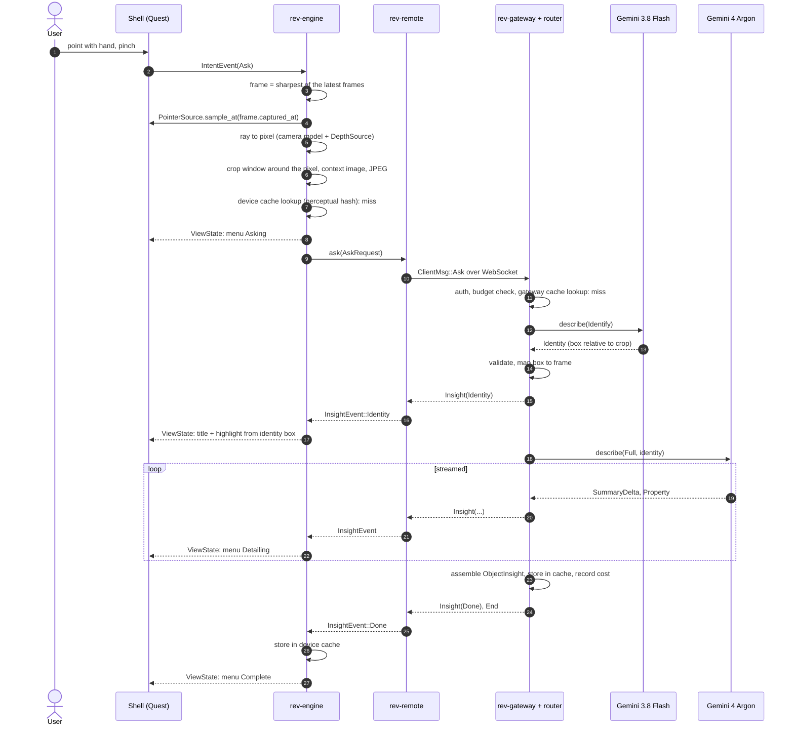
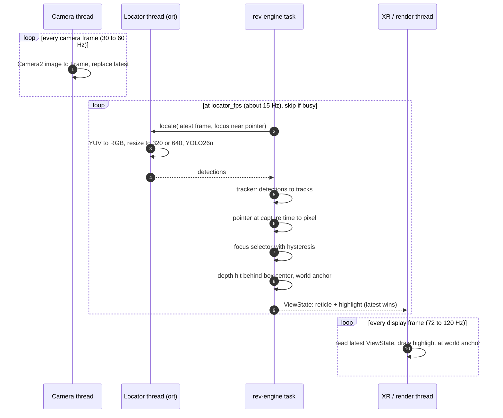
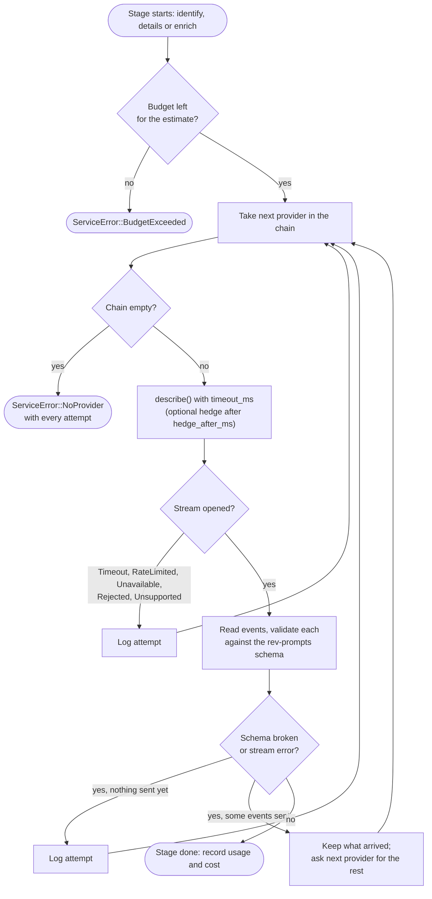
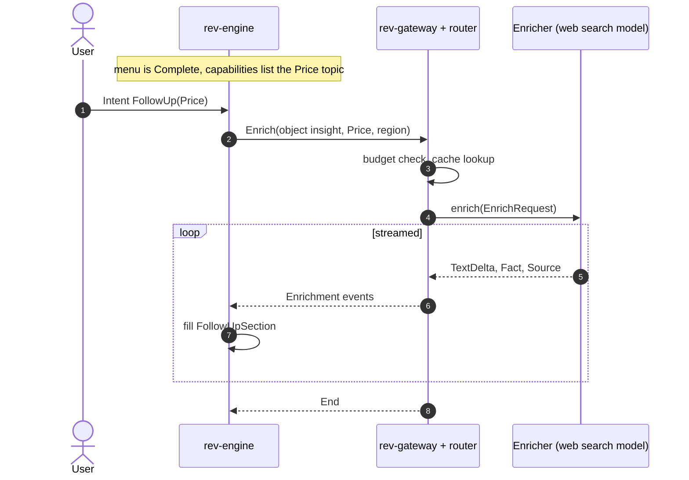
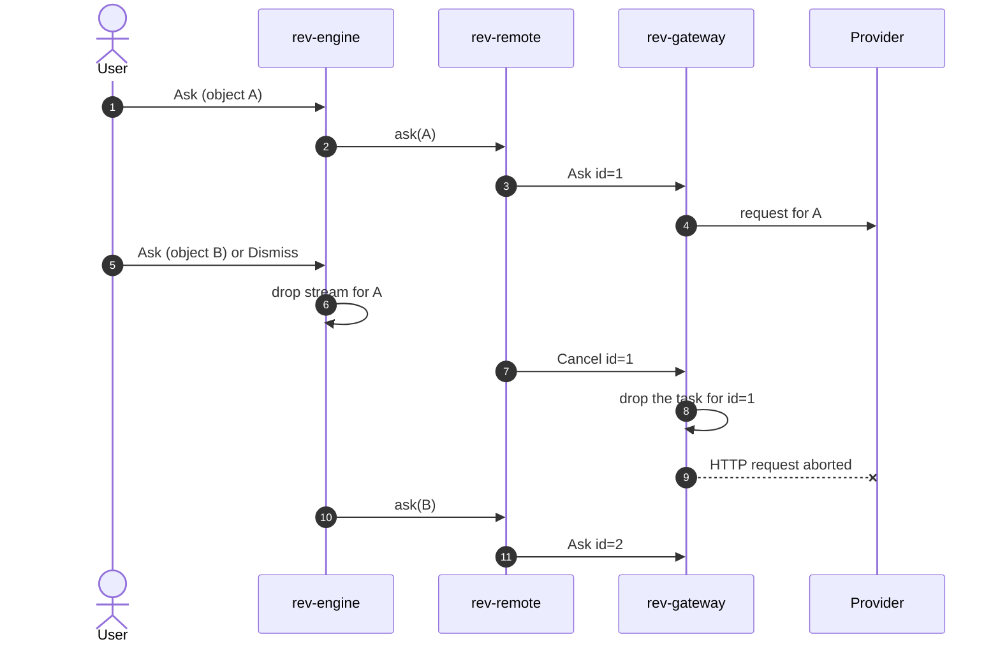
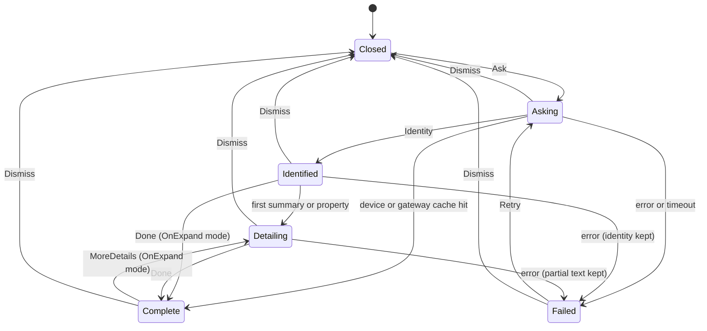
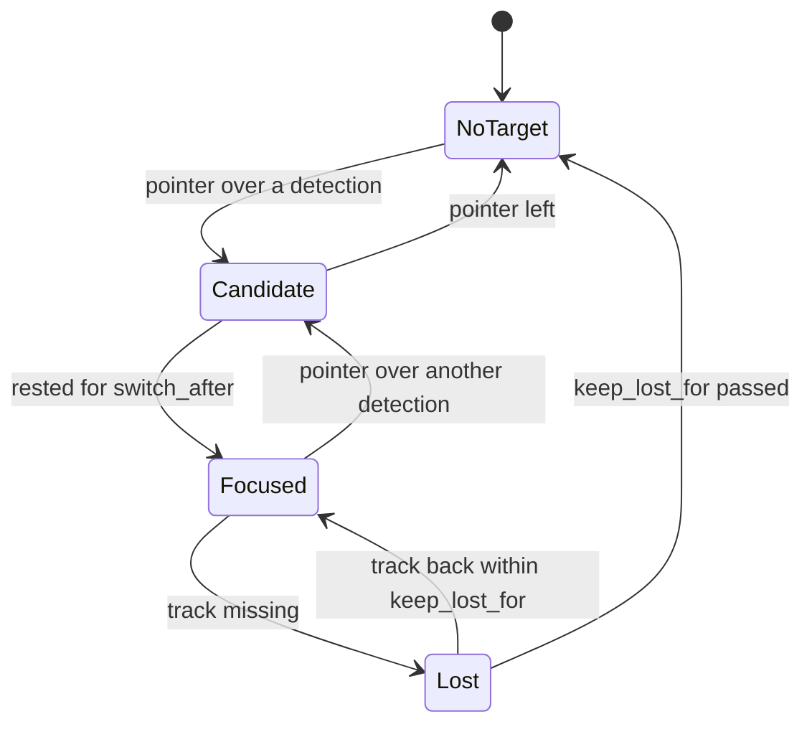
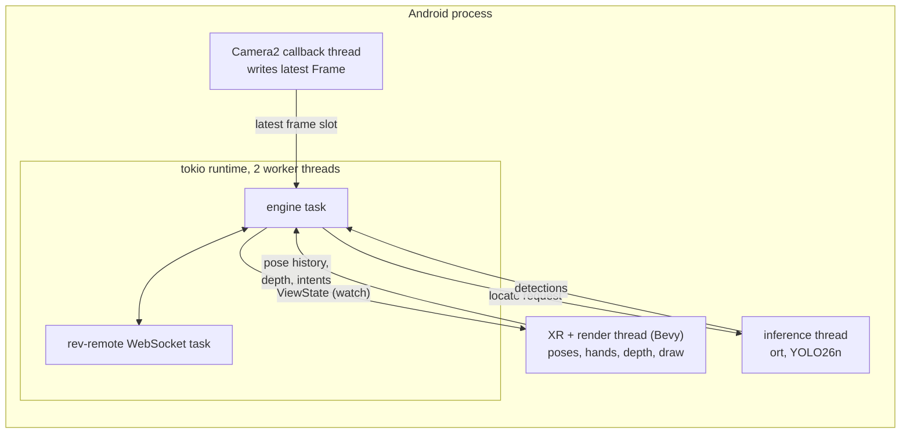

# Data flow

Status: proposed, 2026-10-25. How data moves through the system in each situation. Names
match [interfaces.md](interfaces.md) and [components.md](components.md).

## 1. Ask, cloud first (phases 1 to 3)

No `Locator` yet. The user points, pinches, and the menu fills in.

Without a `Locator` the highlight appears only once the identity arrives, and it stays
where the object was in that frame (no tracking). Good enough to measure the end-to-end
latency, which is what phases 1 to 3 are for.

## 2. Highlight loop (phase 4)

Runs continuously while the user points. Nothing here leaves the device.

Three loops at three rates, joined only by "latest value" slots. A slow model lowers the
highlight's update rate; it never stalls the display.

## 3. Ask with a Locator (phase 4 and later)

Same as flow 1, with three differences:

1. The crop is the focused track's box plus padding, not a window around the pointer.
2. The device cache is first checked by `TrackId`: asking again about the same object while
   it is still tracked opens the menu instantly at no cost.
3. The Locator's label goes along as `hint`, and the highlight is already on screen before
   the request leaves.

## 4. Router chain and fallback

Every attempt (provider, latency, outcome, cost) is logged, so the scoring harness and
production logs show which providers actually carry the load.

## 5. Follow-up question (Enricher, phase 5)

The menu only shows follow-up buttons for topics in `ServiceCapabilities.topics`, so
clients need no update when a topic is added on the gateway.

## 6. Cancel and supersede

Only one ask is active per client. Whatever was already spent on A is still recorded.

## State machines

### Menu

A new `Ask` from any state cancels the current request and goes to `Asking`.

### Focus (phase 4)

The highlight is drawn in `Focused` and `Lost`; `Candidate` shows only the reticle. This
keeps the highlight from flickering between neighbouring objects.

## Caching

Two levels. Both store finished `ObjectInsight`s, never images.

| Level | Where | Key | Lifetime |
| --- | --- | --- | --- |
| Device | `rev-engine` | `TrackId` (phase 4); perceptual hash of the crop, 64-bit dHash, Hamming distance at most 6 | Track: while tracked. Hash: LRU of 256 entries, cleared when the app closes |
| Gateway | `rev-router` (`moka`) | dHash of the crop, `hint` label, locale, stage, prompt version, chain id | 24 h TTL, size-capped; scoped per auth token by default |

A hash hit is accepted only if the hint labels agree (when both exist), to keep two
similar-looking objects from sharing an answer. Cache hits still log an event (with zero
cost) so hit rates are visible.

## Latency budget

Targets, to be measured in phases 1, 3 and 4.

| Stage | Highlight loop | Context menu, first line |
| --- | --- | --- |
| Camera capture | 20 to 40 ms (Meta figure) | 20 to 40 ms |
| YUV to RGB, crop, resize | under 5 ms | under 10 ms + JPEG encode (about 5 ms) |
| Model | under 40 ms on device | identify under 1.5 s, streamed |
| Network | none | 50 to 150 ms over Wi-Fi, WebSocket already open |
| **Total** | **under 100 ms** | **under 2 s to the name** |

Levers if the menu is too slow: smaller crops (fewer image tokens), `DetailsMode::Parallel`,
hedging, a faster identify model, a gateway region closer to the user.

## Threads and tasks on the Quest

The render thread never waits on anything else. It reads the latest `ViewState` and draws.
